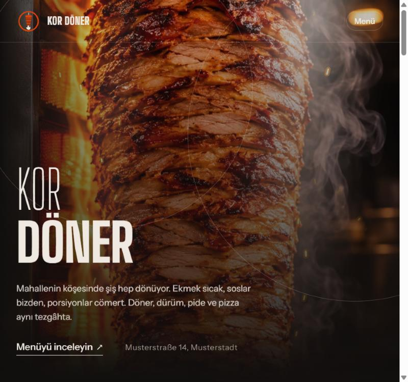

# Kor Döner: Restaurant Website

A one-page website for a döner, pide and pizza restaurant, with an animated rotating döner
spit, smoke and sparks in the hero section, 3D tilt cards and a tabbed interactive menu.

> **Portfolio project.** Kor Döner is a fictional restaurant; the address is a placeholder
> and the food photos are AI-generated. The site is in Turkish.

**▶ Live demo: [erenalmis.github.io/kor-doner](https://erenalmis.github.io/kor-doner/)**



## Highlights

- **Animated hero:** the meat on the spit rotates on a `<canvas>` with smoke and spark particles.
- **Interactive menu:** 8 categories rendered from a single JavaScript data array, so prices are
  easy to update.
- **Table reservations:** guests pick a party size, day and time. Full and past slots are disabled,
  nearly full slots are marked, and a live summary fills in as they choose. Duplicate bookings from the
  same phone number are blocked.
- **Owner panel** (`panel.html`): reservations grouped by day, with confirm, cancel and undo actions.
  In this demo, reservations are stored in the browser (`localStorage`); `store.js` is the only
  file to swap for a real backend API.
- **3D tilt cards** for featured dishes, with a light glare effect.
- **Custom vector logo** (inline SVG `<symbol>`) and a matching favicon.
- **Responsive and accessible:** works on phones; it uses ARIA tabs, keyboard navigation and
  respects `prefers-reduced-motion`.
- **Fast:** no frameworks or build step; self-hosted fonts are preloaded.

## Tech

HTML · CSS · vanilla JavaScript (Canvas API). No dependencies.

## Run locally

Open `index.html` in a browser, or serve the folder:

```bash
python -m http.server 8080
```
